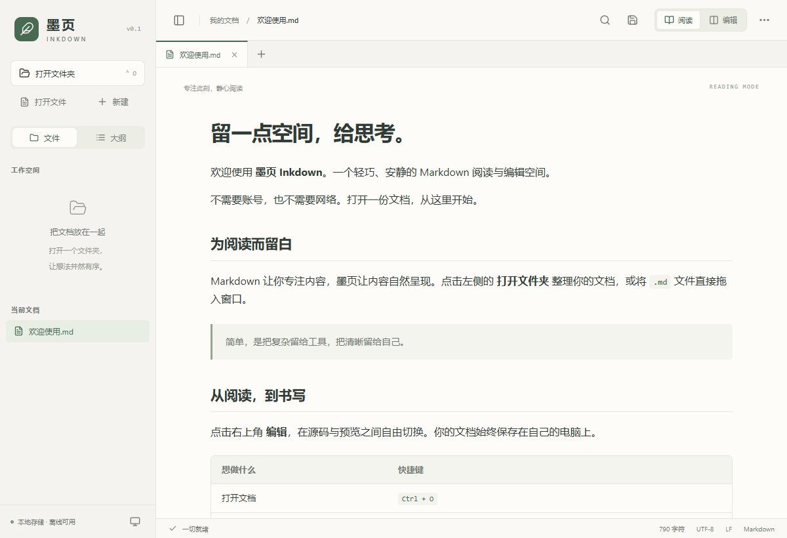

# 墨页 Inkdown

面向 Windows 10/11 x64 的轻量、离线 Markdown 阅读与编辑器。Tauri 2 + Svelte 5 + TypeScript，复用系统 WebView2，不打包 Chromium。

[产品网站与下载](http://150.158.39.166/inkdown/) · [GitHub Releases（HTTPS 备用下载）](https://github.com/machaoxin0407/inkdown/releases/latest) · [反馈问题](https://github.com/machaoxin0407/inkdown/issues)



免费开源，采用 [MIT 许可](LICENSE)。第三方组件仍适用各自许可，详见 [第三方许可声明](THIRD_PARTY_NOTICES.txt)。当前发行版未签名，不包含自动更新。

## 使用

### 本地笔记本（v0.4.0）

- 点击侧栏或工具栏的「笔记本」，选择空文件夹创建笔记库，或打开已有墨页笔记库。普通资料文件夹请通过「导入 Markdown」复制接入。
- 使用「笔记本 → 章节 → 笔记」组织知识点；章节只有一层，笔记也可直接放在笔记本下。名称对应磁盘文件名，正文标题可自由编辑。
- 列表支持手动排序、最近修改排序和标题／正文搜索，可搜索整个笔记库或当前笔记本。拖动可排序或移入另一分类；每项的「⋯」菜单也提供移动、重命名、上下移动和回收站操作。
- 新建笔记立即建立 `.md` 文件；可选知识点模板。笔记库内的笔记停止输入 2 秒后自动保存，持续输入最长每 10 秒保存一次，中文输入组合期间延后。普通文件仍使用原有的手动保存方式。
- 保存状态显示在正文上方。发生磁盘冲突或保存失败时保留编辑及草稿；通过比较版本、重新加载、另存为或手动重试处理，不会自动覆盖外部修改。
- 支持粘贴截图、选择和拖入本地图片；「插入笔记链接」可搜索并插入另一篇笔记的标准相对链接。网页文字按纯文本粘贴；网络图片不会自动下载，可截图粘贴或下载后导入。
- 导入可多选 Markdown，同时复制可读取的本地图片并处理同批笔记间的链接。预检会列出缺图、远程图片、未一同导入的关联文件；原文件不修改。第一版不递归导入文件夹。
- 重命名或移动前显示影响摘要，更新库内的相对链接和图片引用；库外引用不更新。操作中断或部分失败时，列表提供「恢复操作」，保留后来编辑的文件时会提示手动检查相关链接。
- 删除移入应用内回收站，可恢复原位置或指定位置。没有自动清空、永久删除或附件清理功能。外部工具直接移动文件不会自动修复引用。
- 正文位于 `笔记库/笔记本/章节/笔记.md`，图片位于 `assets/<笔记ID>/`；`.inkdown/` 保存分类顺序、颜色、回收站和恢复记录。**备份时复制整个笔记库，包括 `assets/` 和 `.inkdown/`**。元数据损坏时可保留备份并按文件夹重建；颜色、排序会重置，旧回收站文件仍保留在原目录。
- 导航栏可分别折叠，窄窗口自动收起笔记列表，`Ctrl+B` 切换笔记本栏。切换「文件／笔记本」保留已打开标签。

桌面验证：先运行 `npm run dev`，构建当前调试程序后执行 `node scripts/check-notebooks.mjs`；也可通过 `INKDOWN_TEST_BINARY` 指定测试程序。验证使用独立笔记库及应用数据目录，不写入个人笔记。

### 文档阅读与编辑

- 运行发布目录中的 `Inkdown.exe`，或使用 NSIS 安装器安装到当前用户。
- 打开 `.md`、`.markdown`、`.mdown` 文件，或拖入文件/文件夹。安装版注册文件类型；是否设为默认程序由 Windows 默认应用设置决定。
- 默认阅读；切换「编辑」进入 CodeMirror 源码和预览分栏。5 MiB 起默认手动刷新预览，可在当前标签启用实时预览。拖动中间分隔线调整比例，也可以聚焦分隔线后按左右方向键。
- 编辑区上下滚动时，预览按源码位置同步滚动；可单独滚动预览，下一次滚动编辑区时恢复联动。公式、图表加载及分栏宽度变化后会重新计算对应位置。
- 使用顶部 − / + 调整文档缩放（50%–200%），点击百分比恢复 100%。支持 Ctrl+滚轮，自动记住比例；编辑文字与预览一起缩放，PDF 保持固定排版。
- 点击右上角「更多操作 → 导出为 PDF」，或按 Ctrl+Shift+P，先检查资源并预览当前正文快照（包含未保存的编辑），可调整纸张、方向、页边距和页码；确认后选择保存位置。最终分页以 PDF 为准，导出保留公式、图表、本地图片与可选择文字，不修改 Markdown 原文件。
- 编辑停止 2 秒后自动备份草稿，持续输入时最长每 10 秒备份一次；启动时可选择恢复、丢弃或稍后处理，也可从「更多操作 → 恢复草稿」再次查看。草稿保存在本机应用数据目录，不覆盖原文件；保存成功或明确放弃后清除。
- 记住最近 200 份文件的阅读位置、编辑光标和阅读/编辑模式；重启或重新打开后恢复。缩放和窗口变化后按源码位置定位。
- 按 Ctrl+P 或顶部文件夹图标快速打开：搜索已打开标签、最近文件和工作区 Markdown 文件名/路径，支持模糊匹配、方向键与 Enter；新增文件后可点击「刷新索引」。
- 普通代码块右上角可一键复制，保留缩进和换行；PDF 不包含复制按钮。
- 文件/大纲侧栏可折叠，文件树按需展开，多标签保留编辑历史和滚动位置。
- 支持表格、任务列表、代码高亮、KaTeX 数学公式、Mermaid 图表和本地图片。所有渲染资源都在应用内，运行不依赖 CDN。
- 点击左下角主题按钮，依次切换跟随系统、浅色、深色。最近文件和已保存文档的标签会话自动恢复。

| 快捷键 | 功能 |
| --- | --- |
| Ctrl+O / Ctrl+Shift+O | 打开文档 / 打开文件夹 |
| Ctrl+P | 快速打开文件 |
| Ctrl+N | 新建文档 |
| Ctrl+S / Ctrl+Shift+S | 保存 / 另存为 |
| Ctrl++ / Ctrl+- | 放大 / 缩小文档 |
| Ctrl+0 | 恢复 100% 缩放 |
| Ctrl+滚轮 | 放大 / 缩小文档（正文或编辑区） |
| Ctrl+E | 切换阅读/编辑 |
| Ctrl+Shift+P | 导出为 PDF |
| Ctrl+F | 阅读查找 / 编辑器搜索替换 |
| Ctrl+Shift+F | 工作区正文搜索 |
| Ctrl+W / Ctrl+Shift+T | 关闭 / 重新打开最近关闭的文件 |
| Alt+← / Alt+→ | 导航后退 / 前进 |
| Ctrl+B | 展开/折叠侧栏 |
| Ctrl+Z / Ctrl+Y（或 Ctrl+Shift+Z） | 撤销 / 重做，阅读模式同样可用 |

## 0.3.0 同步、性能与文档操作

- 工作区监听、文件创建、重命名及手动刷新共用串行协调器；300 ms 合并重复路径，结构变化完整校准。树刷新保留展开与已加载数量，工作区切换后丢弃旧结果。
- 正文搜索在编辑、保存和外部变化后 250 ms 防抖刷新，中文输入组合期间暂停。点击旧结果时重新核对正文，匹配消失会提示并定位原章节附近；结果上限仍为 500 条。
- 监听不可用时每 10 秒校准文件树、已加载索引及已打开文档，保护未保存编辑；按 10、20、40、60 秒退避重试，随后每 60 秒重试，恢复时完整校准。
- UTF-8 大小 ≥5 MiB 默认手动预览，可点击「刷新预览」或在当前标签「启用实时预览」。预览落后时提示，并暂停链接、任务等依赖旧正文的交互。预览解析可取消，PDF 使用独立 Worker。
- 保存冲突及外部修改可「比较版本」：只读双栏按行标记差异；耗时过长时显示完整双栏。支持取消、重新加载、另存为与明确覆盖，覆盖仍检查磁盘指纹，不自动合并。
- 后退/前进记录文档、标签、链接、大纲及搜索跳转，恢复源码位置与光标；最多 100 条，工作区切换清空。重新打开保留最近 20 个已关闭文件的位置并重新读盘，不恢复明确丢弃的内容。
- 阅读模式可勾选任务列表，通过共享编辑状态形成独立可撤销操作；更新草稿与搜索，不自动保存。菜单提供撤销/重做。
- 重命名先展示引用文件、匹配数量与差异，可取消选项或「仅重命名」。支持标准行内链接及引用式链接定义，只替换确实指向目标的相对 URL，保留标题、锚点及编码；排除代码、图片、外链和工作区外目标。链接与图片共用的引用定义会提示并跳过，以免更改图片。
- 引用更新先核对预览版本；未保存文档仅修改编辑缓冲区，其余文件按指纹原子保存并保留 BOM/换行。多文件操作逐项报告成功、冲突和失败，可重新扫描失败项；不保证跨文件原子性。
- PDF 预检列出缺图、公式和图表错误及源码行。白底预览按实际可用纸宽排版；预检、预览、导出复用同一份已增强快照，出现资源错误时默认返回修复，也可明确继续。

新增验证：`node scripts/check-v030.mjs`（浏览器）、`node scripts/check-v030.mjs --native`（安装包）、`node scripts/benchmark-v030.mjs baseline` / `current`（同机对照）。原生脚本通过 `INKDOWN_TEST_BINARY` 指定程序，使用独立数据目录；一次只运行一个原生脚本。实测见 `VALIDATION.md`。

## 阅读与工作区效率

- 阅读查找支持跨加粗、链接和行内代码匹配，可切换区分大小写；不跨段落、表格单元格、公式或图表。关闭查找后切换主题不会恢复高亮。
- 工作区文件变化自动同步，文件树刷新保留展开状态。没有未保存修改的文档自动重载；正在编辑的未保存内容保留并提示冲突。监听不可用时显示提示并使用定时检查。
- `Ctrl+P` 复用本次会话的文件索引；刷新索引进行完整校准。`Ctrl+Shift+F` 搜索工作区正文，包括已打开文件的未保存内容，最多返回 500 个匹配；点击结果定位到编辑器。
- 文件树支持新建文档、新建文件夹、Markdown 文件同目录重命名和资源管理器定位。重命名不覆盖已有文件，引用更新需在预览中选择；不提供删除和移动功能。
- 大纲支持过滤、层级折叠及当前章节高亮，状态栏显示阅读进度。
- 编辑工具栏可插入链接、表格和本地图片，支持粘贴图片；附件保存在文档旁的 `assets/`。未命名文档先保存，取消保存不会写入附件。撤销图片引用不会删除附件文件。
- “更多操作 → 设置”可设置字体、14–24 px 字号、1.4–2.2 行距和 640–1200 px 正文宽度，文档缩放独立生效。
- PDF 设置支持 A4/Letter、纵向/横向、四边 5–50 mm 页边距和原生页码；默认维持 A4 纵向、15 mm、关闭页码。启用原生页眉页脚时由 WebView2 排版，内部页面地址不输出。
- 预览复用未变化的块、公式和图表，本地图片接近视口才读取；PDF 完整加载所有资源。图片缓存上限 32 MiB，图表缓存上限 8 MiB。

新增验证命令：`node scripts/check-v020-ui.mjs`、`node scripts/check-v020-native.mjs`、`node scripts/benchmark-v020.mjs current`。原生检查通过 `INKDOWN_TEST_BINARY` 指定安装器解包程序，使用独立应用数据目录。

## 文件与离线行为

- 第一版支持 UTF-8，保留 BOM 及 LF/CRLF；混合换行统一为文件中占多数的格式。非 UTF-8 文件会明确报错，绝不按错误编码覆盖。
- 文件保存前后比较 SHA-256 指纹，写入同目录临时文件并同步，再原子替换目标。外部修改会要求重新加载、另存为或明确覆盖；只读和失败操作保留编辑内容。
- 关闭标签、退出和切换工作区会询问未保存修改。意外退出后可恢复最近一次成功备份的草稿；最后一个备份间隔内的输入可能尚未落盘。恢复不自动覆盖源文件，磁盘已变化时仍需处理保存冲突。
- 单文档上限 32 MiB，单图片上限 16 MiB。工作区隐藏点号目录、`node_modules`、`target`、`dist` 和符号链接；每级树先显示 150 项，可继续加载。
- 本地图片仅允许相对路径，规范化后必须位于文档目录，或文档所属的已打开工作区内。不加载网络图片；HTTP(S)/邮件链接只有用户点击才会交给系统打开。
- 原始 HTML 作为文本显示，渲染 HTML/SVG 经 DOMPurify 清理；KaTeX 禁用受信任命令，Mermaid 严格模式；CSP 禁止远程资源、iframe、对象和表单提交。
- 首次安装到没有 WebView2 的机器时需要联网安装微软运行时；已有 WebView2 的机器上可离线运行。WebView2 运行时的安装体积和浏览器缓存不算应用本体体积。

## 开发与构建

需要 Node.js 22.12+、Rust stable MSVC 工具链、Visual Studio 2022 Build Tools 的 C++ 工作负载及 Windows SDK。

```powershell
npm ci
npm run desktop          # 启动 Tauri 开发窗口
npm run package          # 检查类型、打包资源、构建 Windows NSIS 安装器
```

当前工作区的 Rust 工具链安装在 `.tools/cargo`、`.tools/rustup`；脚本会自动识别。C++ 工具安装在 `.tools/vs`，通过 Visual Studio 注册表发现。其他电脑可使用常规全局工具链。

```powershell
npm run dev              # 仅浏览器界面预览，本地文件操作需桌面版
npm run check
npm test
powershell -NoProfile -ExecutionPolicy Bypass -File scripts/desktop.ps1 test
node scripts/check-ui.mjs       # 需先启动 npm run dev，需本机 Chrome
node scripts/check-productivity.mjs # 草稿、位置、快速打开与原生剪贴板
node scripts/check-zoom.mjs --native # 桌面缩放、持久化与同步滚动
node scripts/check-native.mjs   # 需先构建 release；不要同时运行其他墨页实例
node scripts/check-reading-fixes.mjs          # 浏览器：图表文字与同步滚动
node scripts/check-reading-fixes.mjs --native # 桌面：图表文字与同步滚动
```

浏览器测试覆盖阅读、编辑、查找、撤销、多标签、主题和布局；桌面测试通过真实 WebView2 和 Rust 后端执行文件操作，文件选择框的返回路径由测试注入，不操作系统对话框。测试文件、截图、报告在 `artifacts/`，使用独立 WebView 配置目录和应用数据目录，不影响正常使用设置。草稿与位置默认存于 `%LOCALAPPDATA%/com.inkdown.reader/`；测试通过进程环境变量 `INKDOWN_DATA_DIR` 隔离这些数据，前端不能指定存储路径。

构建输出：`src-tauri/target/release/inkdown.exe`；安装器：`src-tauri/target/release/bundle/nsis/`。首次构建需要从 crates.io、npm 和 Tauri GitHub release 下载构建依赖。发行文件未进行代码签名。

`release/` 提供已构建的安装器、免安装程序、打包 ZIP、示例、许可和 SHA-256 校验文件。详细实测和验证边界见 `VALIDATION.md`。开发工具、`node_modules` 和 `target` 不属于发布包。

构建后执行 `powershell -NoProfile -ExecutionPolicy Bypass -File scripts/collect-release.ps1` 整理交付目录。依赖更新后执行 `python scripts/generate-notices.py` 更新第三方许可文本，然后重新打包。

## 代码结构

- `src/App.svelte`：标签、工作区、快捷键、保存与冲突决策。
- `src/lib/workspace.ts`：串行变化协调、索引和搜索类型。
- `src/lib/document-state.ts`、`navigation.ts`：共享可撤销事务、输入同步、导航与关闭记录。
- `src/lib/rename.ts`、`references.ts`：引用识别、预览版本校验和逐文件应用。
- `src/lib/pdf.ts`：不可变导出快照、资源预检、轻量预览和清理。
- `src/lib/` 其他模块：Tauri 桥接、独立解析/差异 Worker、分批清理与视口增强。
- `src-tauri/src/lib.rs`：文件读取、指纹检查、安全保存、目录和图片访问、单实例文件转发。
- `examples/`：正常渲染、错误隔离、安全输入和本地图片示例。

当前版本不包含云同步、插件、自动更新，以及文件树中的删除/移动功能。PDF 默认使用 A4 纵向；可在设置中选择 A4/Letter、纵向/横向、5–50 mm 页边距及原生页码。

## 贡献与网站部署

欢迎通过 Issues 报告问题（附版本、重现步骤及不含隐私的示例），或提交 Pull Request。修改应用后运行 `npm test` 与 `npm run check`；文件操作的修改还需运行 Rust 单测及桌面验证。不要提交凭据、个人文件、依赖目录或构建产物。

网站为 `website/` 中的静态文件。自动部署、软件发行和回滚步骤见 [DEPLOYMENT.md](DEPLOYMENT.md)。网站自动部署与桌面软件自动更新是不同功能：桌面软件仍需手动下载安装新版。
